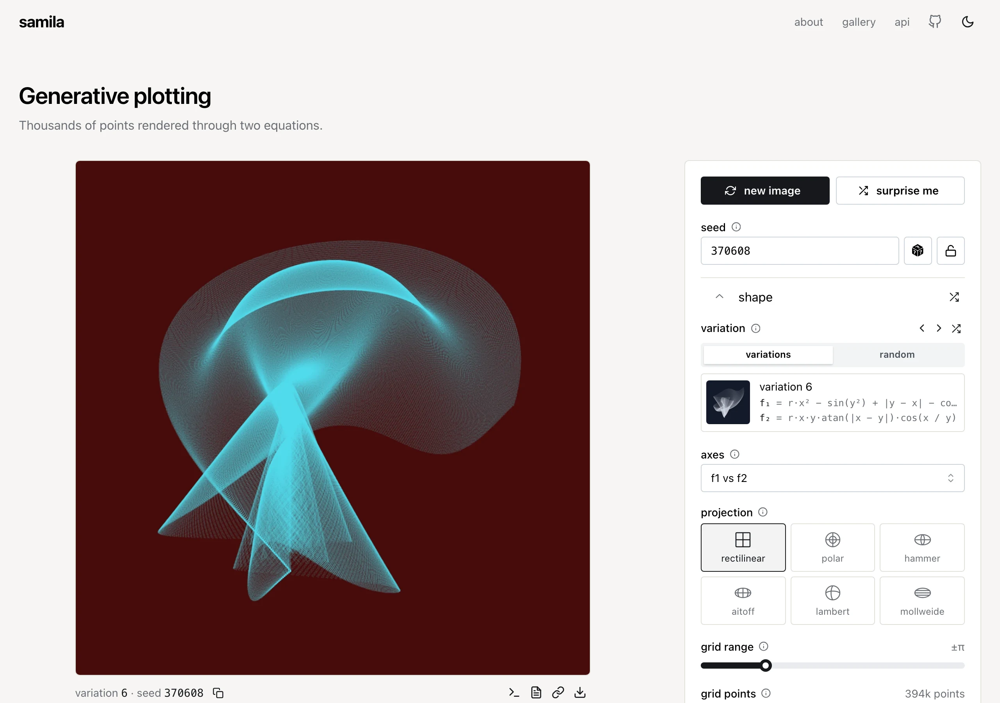
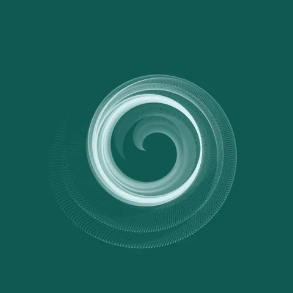
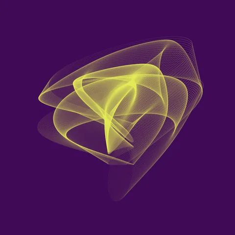

# samila

Generative art web app and HTTP API powered by [samila](https://github.com/sepandhaghighi/samila), fastapi, and next.js

## demo

https://samila.evanslack.dev

## screenshots

<picture>
  <source media="(prefers-color-scheme: dark)" srcset="docs/screenshot-dark.webp">
  
</picture>

<br>

<p>
  
  
  
  
  
  
</p>

## getting started

Can run from a prebuilt container, `evanofslack/samila:latest`, which serves both the web app and
the API on port 8080:

```yaml
services:
  samila:
    image: evanofslack/samila:latest
    restart: unless-stopped
    ports:
      - 8080:8080
```

Then open http://localhost:8080.

## api

`GET /api/image` returns a PNG, 1000×1000 by default (`size` sets 500–4000 px). Every parameter is
optional, and the seed used is returned in the `X-Seed` header, so any image can be reproduced.

```sh
curl -o art.png "https://samila.evanslack.dev/api/image?eq=7&seed=4242&proj=polar&color=ffffff&bg=000000&size=2000"
```

Parameters, limits and errors are documented at [`/api/docs`](https://samila.evanslack.dev/api/docs)
and in [`api/README.md`](api/README.md).

## configuration

| variable | default | |
|---|---|---|
| `PORT` | `8080` | listen port for `python -m app.main` (the docker image always listens on 8080) |
| `STATIC_DIR` | unset (`/app/static` in docker) | serve the web export at `/` |
| `RENDER_WORKERS` | `2` | render processes |
| `RENDER_QUEUE` | `4` | renders allowed to wait for a worker before returning 503 |
| `RENDER_TIMEOUT_SECONDS` | `30` | returns 504 after this |
| `RATE_LIMIT_PER_MINUTE` | `10` | image requests per client ip |
| `GLOBAL_RATE_LIMIT_PER_MINUTE` | `60` | image requests across all clients |
| `TRUST_PROXY` | `false` | take the client ip from `CLIENT_IP_HEADER`. only enable behind a reverse proxy |
| `CLIENT_IP_HEADER` | `X-Forwarded-For` | rightmost entry for `X-Forwarded-For`, else the header's value (e.g. `CF-Connecting-IP`) |
| `DOCS_ENABLED` | `true` | serve `/api/docs` and `/api/openapi.json` |
| `LOG_LEVEL` | `info` | |

## development

The repo has two parts, shipped together in one image:

- `web/`: next.js + mantine frontend, built as a static export
- `api/`: fastapi backend that renders images with samila and serves the frontend

Run the api and next dev server with hot reload (needs [uv](https://docs.astral.sh/uv/), node 24 and
[just](https://github.com/casey/just)):

```bash
just start
```

Then open http://localhost:3000. Run `just serve` for a production-like build on :8080, `just check`
for the same checks as CI, or `just` to list all recipes. Or build and run the production image from
local code:

```bash
just docker-run
```
